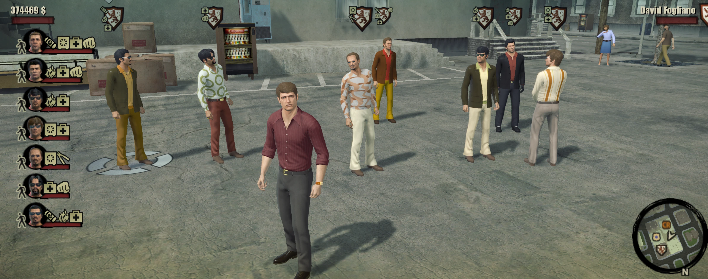

# Bigger Crew: Increase the Crew Limit in The Godfather II

**Version 1.0.1.** [Download Bigger Crew on Patreon](https://www.patreon.com/c/gf2mod).

The Godfather II only lets you take **3 crew members** with you. This mod increases the crew limit to **20**, or any number from 1
to 127, so you can roll into a rival compound with a real army behind you.

## Features

- Higher crew limit in the **Family menu** (Don view, "Add to crew").
- Higher crew limit when **recruiting on the street** by aiming at a family member.
- Each one can be turned on and off separately.

## Options

| Option | Values | Default |
|---|---|---|
| Maximum crew size (`Crew.MaxCrew`) | 1 to 127 | 20 |

## Modules

| Module | What it does | Default |
|---|---|---|
| `family_menu_limit` | Crew limit in the Family menu (Don view) | On |
| `street_limit` | Crew limit when recruiting on the street | On |

## Requirements

- [gf2mod manager](../manager.md)
- The Godfather II version 1.0.789

## Install

Put `bodyguard.gf2mod` into the `mods` folder of the game, or drop it onto the gf2mod window, make sure it's ticked and press
**PLAY**.

## Good to know

- Pairs well with [Recruitable Soldiers](recruitable-soldiers.md): with 3 made men in your crew, the game only offers "recruit" when
  the limit is raised.
- Saving and loading with more than 3 crew members has not been tested much yet. Please report any problem.
