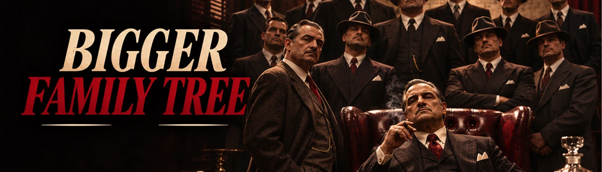
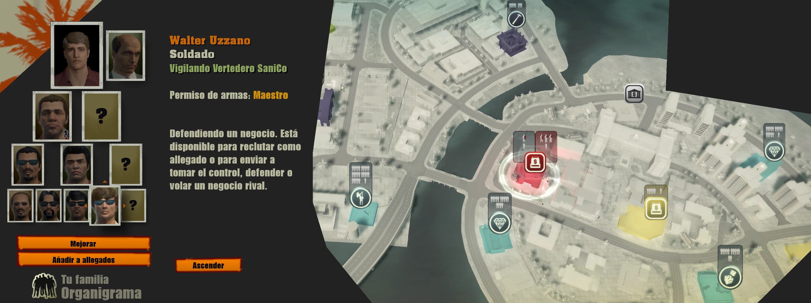
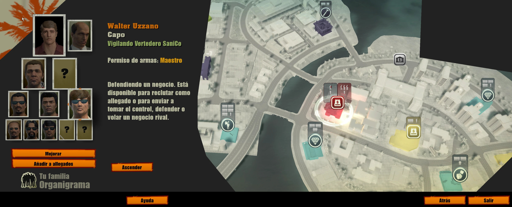
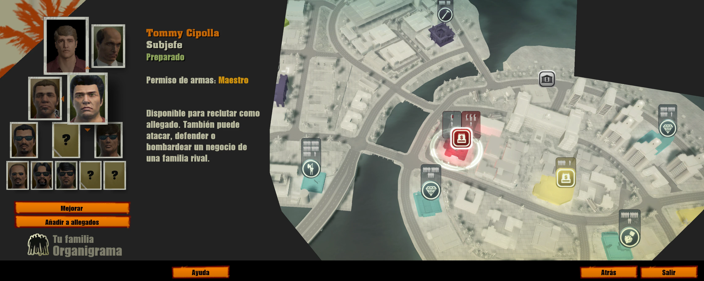

# Bigger Family Tree: More Made Men in The Godfather II

**Version 1.0.1.** [Download Bigger Family Tree on Patreon](https://www.patreon.com/c/gf2mod).

A real family needs more than 7 made men. This mod grows your family tree in The Godfather II to **10 slots: 2 underbosses, 3 capos
and 5 soldiers**. The game has 1, 2 and 4.

## Features

- **3 new slots:** a second underboss, a third capo and a fifth soldier.
- **Natural progression:** each new slot unlocks with the last original slot of its rank, so the game's pacing stays the same.
  Soldier 5 comes with soldier 4, capo 3 with capo 2 and underboss 2 with the underboss.
- **Redesigned Don view:** the tree shows all 12 nodes (Don, consigliere and the 10 made men) with working navigation.

## Options

This mod has no options, only modules.

## Modules

| Module | What it does | Default |
|---|---|---|
| `slots` | Tree data: 7 to 10 slots | On |
| `screen` | Don view with 2 underbosses, 3 capos and 5 soldiers. It needs `slots`. | On |

## Requirements

- [gf2mod manager](../manager.md)
- The Godfather II version 1.0.789

## Install

Put `family.gf2mod` into the `mods` folder of the game, or drop it onto the gf2mod window, make sure it's ticked and press **PLAY**.
It works with new and existing saves.

## Good to know

- Save games keep their normal format. If you remove the mod with more than 1 underboss, 2 capos or 4 soldiers, the extra members
  have no slot when the save loads, so keep the mod while you use those slots.
- The tree screen is changed in memory. No game file is modified.
- Pairs well with [Bigger Crew](bigger-crew.md), to take more of your made men into the field.
