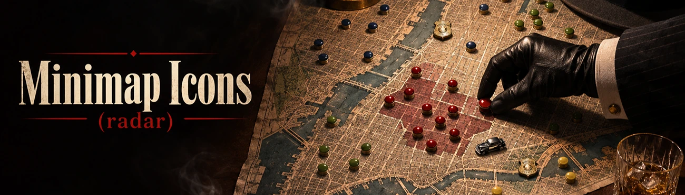
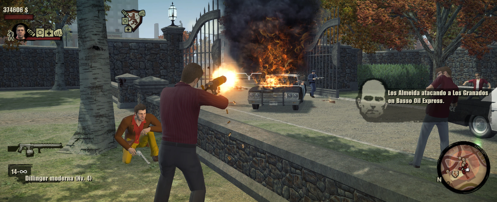

# Minimap Icons: Show Crew, Enemies and Police on the Radar in The Godfather II

**Version 1.0.0.** [Download Minimap Icons on Patreon](https://www.patreon.com/c/gf2mod).

The minimap in The Godfather II shows buildings and objectives, but not the people who matter. This mod puts your crew, rival
families, police and your last car on the radar.

It doesn't paint dots over the screen: it uses the **game's own radar markers**. Icons follow each person, turn and zoom with the
minimap, are clipped by its round border and work at **any resolution and aspect ratio** with **no calibration**.

## What you see

| Who | Icon | Colour |
|---|---|---|
| Your crew | Small figure | Corleone colour |
| Your soldiers | Dot | Corleone colour |
| Rival families | Dot | The family's official colour, taken from the game |
| Police in New York, Miami and Cuba | The game's police icon | Its own |
| Security guards and fake police | Dot | Grey |
| Your last car | Square | White, gone when you get back in |

Enemies, police and guards that are close but out of range **stay on the edge of the radar**, pointing to where they are. Civilians
are left out, so the map stays clean.

## Options

| Option | Values | Default |
|---|---|---|
| Who gets an icon (`Show.Groups`) | crew, soldiers, enemies, police, guards, car | All |
| Icon size in % (`Icons.Size`) | 20 to 100 | 55 |
| Distance kept on the radar edge, in metres (`Icons.EdgeDistance`) | 20 to 1000 | 150 |

## Modules

| Module | What it does | Default |
|---|---|---|
| `markers` | Icons for people and your car on the minimap | On |

## Requirements

- [gf2mod manager](../manager.md)
- The Godfather II version 1.0.789

## Install

Put `radar.gf2mod` into the `mods` folder of the game, or drop it onto the gf2mod window, make sure it's ticked and press **PLAY**.

## Good to know

- Works with [Bigger Crew](bigger-crew.md), [Recruitable Soldiers](recruitable-soldiers.md) and
  [Bigger Family Tree](bigger-family-tree.md): every crew member and recruited soldier gets an icon.
- If you use another minimap dots plugin, turn one of them off so you don't get two dots per person.
- Nothing is saved in your save game. Turn the mod off and the radar is back to normal.
