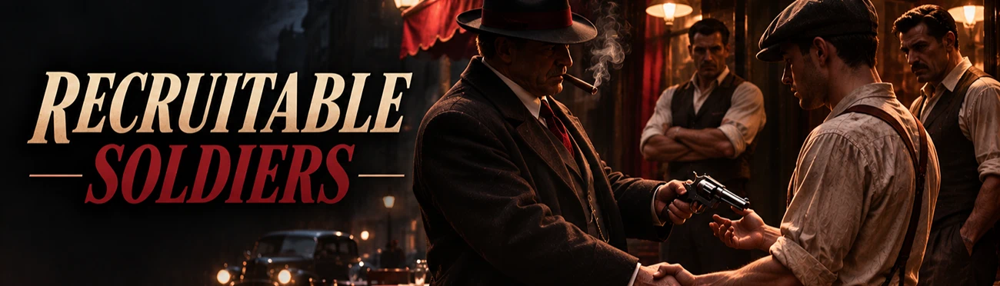
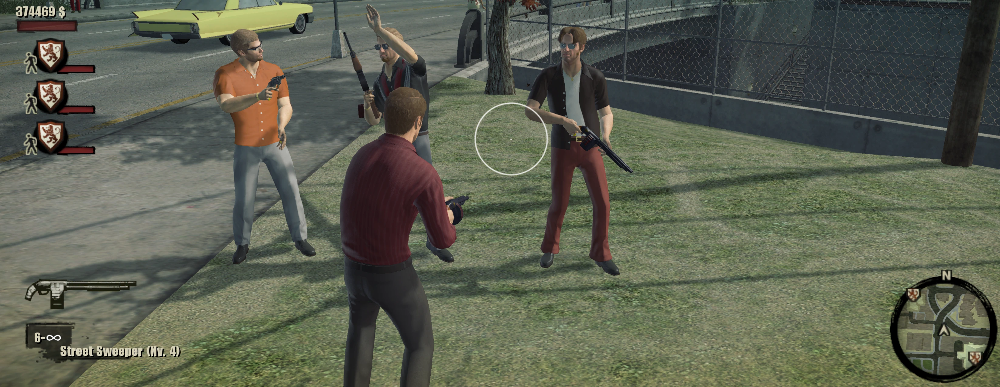
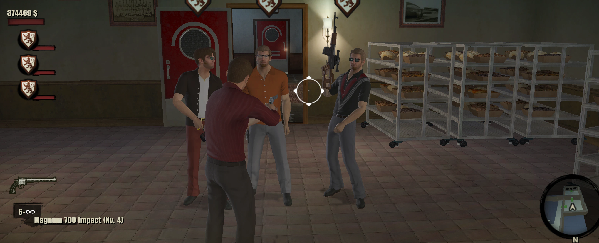

# Recruitable Soldiers: Recruit Venue Guards in The Godfather II

**Version 1.0.1.** [Download Recruitable Soldiers on Patreon](https://www.patreon.com/c/gf2mod).

In The Godfather II your businesses are full of loyal soldiers, but the game never lets you take them along. With this mod, walk up
to one of **your own venue guards**, press **E** and recruit him into your crew.

## Features

- **Recruit venue guards** of your family with E, the same way you recruit made men.
- **They stay with you:** a recruited soldier no longer disappears when you leave his venue. The venue sends a new guard.
- **Random weapon** on recruitment: low-level weapons are common and high-level ones are rare.
- **Corleone crest on the HUD:** soldiers have no portrait, so their slot shows the crest with a shorter health bar.
- **Only real guards:** story characters, made men and members of other families keep their own dialogue.

## Options

| Option | Values | Default |
|---|---|---|
| Weapon types (`Weapons.Types`) | pistol, magnum, shotgun, automatic, rifle | All |
| Lowest weapon level (`Weapons.MinLevel`) | 1 to 4 | 1 |
| Highest weapon level (`Weapons.MaxLevel`) | 1 to 4 | 4 |
| Chance of levels 1, 2, 3, 4 in % (`Weapons.LevelWeights`) | List of 4 numbers | 60,25,10,5 |
| Crest offset, x (`Crest.X`) | -50 to 50 | 0 |
| Crest offset, y (`Crest.Y`) | -50 to 50 | 0 |
| Crest scale in % (`Crest.Scale`) | 10 to 200 | 72 |
| Soldiers' health bar width (`Crest.HealthBarWidth`) | 10 to 90 | 45 |

Weapon levels 3 and 4 need the DLC weapons.

## Modules

| Module | What it does | Default |
|---|---|---|
| `recruit` | Venue guards can be recruited | On |
| `keep` | Recruited soldiers stay with you when you leave their venue | On |
| `random_weapon` | Recruited soldiers get a random weapon | On |
| `crest` | Corleone crest on the HUD for crew members without a face | On |

## Requirements

- [gf2mod manager](../manager.md)
- The Godfather II version 1.0.789
- Recommended: [Bigger Crew](bigger-crew.md). With 3 made men in your crew, the game only offers "recruit" if the limit is raised.

## Install

Put `soldiers.gf2mod` into the `mods` folder of the game, or drop it onto the gf2mod window, make sure it's ticked and press **PLAY**.

## Good to know

- A soldier you remove from your crew stays where he is, since he no longer belongs to his venue.
- The HUD change is applied in memory. No game file is modified.
